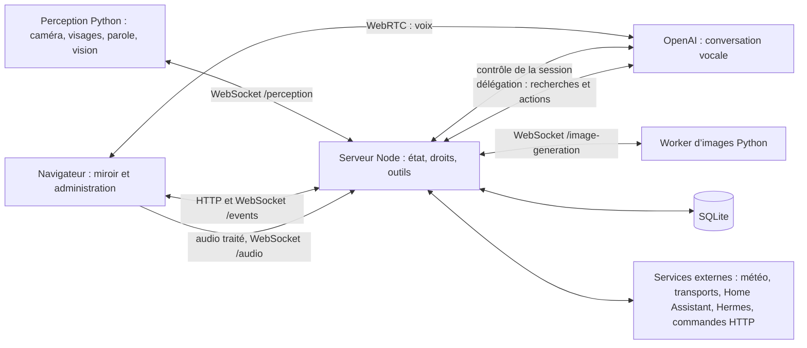

# Architecture

Cette page décrit comment Cornelius est construit aujourd’hui : les parties qui tournent sur la machine, le déroulement d’une conversation, l’état partagé, les données gardées et la façon dont le système résiste aux pannes. Elle s’adresse aux personnes qui lisent ou modifient le code. Les fonctions vues par l’utilisateur sont expliquées dans les pages [Fonctionnalités](../README.md).

## Vue d’ensemble

| Partie | Code | Rôle |
|---|---|---|
| Serveur | `server/` (Node.js, Fastify) | Seule autorité : présence, profil actif, ouverture et fermeture des conversations, outils, droits, données. Écoute sur `127.0.0.1` uniquement (`server/index.ts`). |
| Miroir | `web/components/Mirror.tsx` | Page publique sur la machine : orbe, cartes, informations permanentes, micro et haut-parleurs. |
| Administration | `web/components/Admin.tsx` | Page protégée par mot de passe : réglages, personnes, modules, diagnostic. |
| Perception | `perception/worker.py` | Processus Python séparé : caméra, détection et reconnaissance des visages (YuNet et SFace), détection de la parole (Silero), mot d’appel (openWakeWord), description de la scène (LFM2.5-VL). Lancé par les scripts ou par systemd, il se connecte au serveur. |
| Worker d’images | `image_generation/worker.py` | Processus Python facultatif, lancé et surveillé par le serveur (`server/image-generation-runtime.ts`) quand la génération d’images est activée. |

Le serveur ne décide jamais sur la seule parole du modèle ni sur la seule image de la caméra : la caméra propose une identité, le modèle propose une réponse, le serveur vérifie les droits et rejette ce qui appartient à une conversation passée.

## Cycle d’une conversation

1. **Présence.** La perception envoie environ dix observations par seconde (visages, identité proposée, regard). Le contrôleur (`server/controller.ts`) confirme la présence, l’identité et le regard selon les délais de présence (`shared/presence-timings.ts`).
2. **Admission.** Quand la condition d’ouverture est remplie (voir ci-dessous), et seulement si le miroir a confirmé que le micro et le son sont prêts (`media_ready`), le contrôleur admet une conversation. Pendant la confirmation de présence, le serveur prépare déjà la connexion HTTPS vers OpenAI (`server/live/gateway.ts`), sans rien créer ni payer.
3. **Connexion.** Le miroir prépare son offre WebRTC (`web/audio/connection.ts`, `web/audio/session.ts`) et l’envoie au serveur (`POST /api/media/offer`). Le serveur crée la session vocale avec sa clé, attache son canal de contrôle et renvoie la réponse. La voix circule ensuite directement entre le navigateur et OpenAI. Le même signal audio, traité par le navigateur, part aussi vers le serveur (`/audio`) pour la détection locale de la parole.
4. **Écoute.** La session est prête quand le serveur a reçu `session.started` sur son canal de contrôle et que le navigateur a signalé la connexion WebRTC (`POST /api/media/status`). L’orbe passe alors à l’écoute.
5. **Réponses.** Le modèle vocal ne reçoit aucune donnée à l’ouverture. Chaque fait (heure, météo, transports, souvenir, appareil, scène) vient d’un outil, exécuté par le serveur après vérification du profil et de la conversation en cours. Les outils et les sources autorisées pour la personne sont décrits dans la configuration de la session (`server/live/configuration.ts`). Le serveur peut ajouter des consignes en cours de route (accueil par le prénom, carte affichée, scène vue) par les canaux de la session (`server/live/transport.ts`). Une délégation accepte au plus 32 appels d’outil.
6. **Fermeture.** Départ, changement de personne, arrêt manuel, blocage d’OpenAI, perte de la perception ou du miroir, fin de parole quand elle est activée : le contrôleur ferme la session, attend la confirmation dans un délai borné, retire les cartes temporaires et invalide les résultats tardifs.
7. **Après.** La mémoire personnelle est extraite de la conversation terminée, sans faire attendre la voix (voir [Mémoire](#mémoire)).

Chaque conversation porte un identifiant d’interaction, une époque de profil et une version de contexte. Un résultat d’outil, une capture ou une carte qui ne correspond plus à ces trois valeurs est ignoré.

## Parcours Groq

Avec `CORNELIUS_AI_PROVIDER=groq`, `web/audio/groq-session.ts` ouvre le WebSocket local `/audio` à la place de la connexion WebRTC OpenAI. Le serveur contrôle toujours le miroir courant et la portée de session. `server/groq.ts` segmente le PCM 16 kHz en mémoire, appelle Whisper puis Chat Completions sur `api.groq.com`, et adapte les résultats aux événements internes de `LiveTransport`. Les outils gardent donc les mêmes validations, autorisations et cartes. Le serveur refuse un outil absent de la liste du profil, borne les tours et annule les requêtes à la clôture.

Le navigateur lit le texte avec une voix française locale et signale le début, la poursuite et la fin de lecture au serveur. Le micro est muet pendant la réponse et le traitement. La mémoire utilise le mode JSON de Groq ; `PersonalMemory` conserve sa validation des preuves et du schéma. Voir [Groq](../fonctionnalites/groq.md) pour les limites.

## Ouverture de la conversation

L’administration pose deux questions : ce qui ouvre la conversation (la présence, le regard ou le mot « Cornelius ») et qui peut l’ouvrir (tout le monde ou les membres du foyer reconnus). `shared/opening.ts` traduit chaque réponse en une seule combinaison de réglages internes, et relit les anciennes combinaisons qui se recouvraient.

| Ce qui ouvre | Qui | Étape interne | Membres reconnus seulement | Mot d’appel | Caméra en veille |
|---|---|---|---|---|---|
| présence | tout le monde | 1 | non | non | allumée |
| présence | membres | 2 | non | non | allumée |
| regard | tout le monde | 3 | non | non | allumée |
| regard | membres | 3 | oui | non | allumée |
| « Cornelius » | tout le monde | 4 | non | oui | éteinte |
| « Cornelius » | membres | 2 | non | oui | allumée |

Les quatre étapes internes (`SessionMode` dans `shared/types.ts`, colonne `session_mode` de la base) :

| Étape | Nom interne | Ouverture |
|---|---|---|
| 1 | dès la détection | Dès qu’une personne est présente, même inconnue. Si elle est reconnue ensuite, le serveur met à jour les outils de la session sans la recréer et ajoute l’accueil par le prénom. Passer ensuite à une autre personne ferme la session. |
| 2 | à l’identification | Quand une personne reconnue est présente de façon stable. Le profil actif est le sien. |
| 3 | à l’engagement | Quand une personne regarde le miroir. Le profil est celui de la personne reconnue, sinon celui du foyer. |
| 4 | au mot d’appel | Au mot « Cornelius », caméra éteinte en veille. La caméra s’allume pendant la conversation si la reconnaissance au mot d’appel ou la vision est active ; une personne reconnue dans les 8 s rattache son profil. |

Par défaut, la conversation s’ouvre au regard, pour tout le monde (étape 3). Le mode vie privée ferme la conversation dès qu’une deuxième personne est vue sur deux images consécutives, et empêche d’en ouvrir une tant qu’il y a du monde. Un arrêt manuel reste actif jusqu’à **Démarrer** ou jusqu’au mot « Cornelius ». Le comportement vu par l’utilisateur est décrit dans [Ouverture et présence](../fonctionnalites/ouverture-et-presence.md).

## État diffusé et WebSocket

Les commandes et les réglages passent par HTTP (`/api/...`, `/api/admin/...` pour l’administration). Les changements d’état passent par le WebSocket `/events` :

- le serveur envoie l’état complet à la connexion, puis chaque changement, avec un numéro de séquence ; un trou dans la séquence impose de relire l’état complet (`GET /api/state`) ;
- un signal léger part chaque seconde pour confirmer que le serveur vit ;
- l’administration (`/events?role=admin`) reçoit en plus l’état des périphériques (`devices`) ; le miroir ne reçoit jamais de réglage réservé ni de secret.

Dans le code, le rôle `kiosk` désigne la page du miroir. Un seul miroir pilote la présence du navigateur : ouvrir le miroir dans un autre onglet ferme le WebSocket du précédent (« Miroir ouvert dans un autre onglet »). Une reconnexion de la même page, reconnue par son identifiant envoyé avec `media_ready`, garde la conversation en cours ; le média ne passe pas par ce WebSocket. Le miroir prouve qu’il vit par des pings ; s’il disparaît plus de 5 s, la conversation se ferme.

Autres canaux : `/audio` (signal du micro vers la détection de parole), `/wake-audio` (veille du mot d’appel), `/perception` (worker de perception, avec le jeton `CORNELIUS_PERCEPTION_TOKEN`) et `/image-generation` (worker d’images, avec son propre jeton).

## Contrats

Les formats échangés entre les parties ont leur schéma JSON dans `schemas/` (cartes, instantanés de modules, observations de présence et de vision, outils de vision et d’images, propositions de mémoire, informations permanentes) et un exemple valide dans `schemas/examples/`. `shared/validation.ts` compile ces schémas ; le serveur valide ce qu’il reçoit du navigateur, de la perception, des modules et du modèle, même quand le modèle est déjà contraint par le schéma de l’outil. Les types partagés par le serveur et l’interface sont dans `shared/`.

## Persistance et sauvegardes

Toutes les données durables sont dans une base SQLite (`data/cornelius.sqlite` par défaut, variable `CORNELIUS_DATABASE`), ouverte par `server/storage.ts` avec les clés étrangères, le journal WAL et `secure_delete` (une donnée supprimée est effacée du fichier). Le serveur est le seul à y écrire. On y trouve les profils et leurs signatures faciales, les préférences (conversation, caméra, vision, images, écoute, son), la personnalité, les sources de modules et leur dernier résultat, les commandes HTTP et leur journal, la mémoire, Home Assistant et les agents.

Les migrations forment une liste unique et ordonnée dans `server/storage.ts` ; la version appliquée est `PRAGMA user_version`. Avant de migrer une base existante, le serveur en fait une copie à côté d’elle. `server/backups.ts` ne garde que les deux copies les plus récentes. Supprimer un profil, oublier un visage ou un souvenir retire aussi la donnée de ces copies (une copie illisible est supprimée) et vide le journal WAL. Il n’existe pas encore de sauvegarde chiffrée ni de restauration (voir la [feuille de route](feuille-de-route.md)).

Hors base : les secrets dans `.env`, les journaux dans `data/logs/` (à côté de la base ; rotation à 5 Mo), les images générées dans `data/generated-images/` (trois au plus, vidé au démarrage), les modèles dans `models/`. Les images de la caméra et l’audio restent en mémoire vive.

## Perception

`perception/worker.py` capture la caméra (`camera.py`), détecte et compare les visages (`vision.py`, `recognition.py`), guide l’enregistrement d’un visage en cinq positions (`enrollment.py`), mesure la parole sur le signal reçu du navigateur (`vad.py`) et écoute le mot d’appel (`wake.py`). La boucle vise 10 observations par seconde, temps de traitement compris, sans rattrapage en rafale. La perception ne décide d’aucun droit : elle propose des observations datées que le contrôleur vérifie. Une observation trop ancienne ou absente pendant 2 s rend la présence indisponible et ferme la conversation.

Les modèles sont téléchargés et vérifiés (empreintes SHA-256 de `perception/models.json`) par `perception/download_models.py`. L’administration lance ce même script pour installer un modèle de vision (`server/model-downloads.ts`), un téléchargement à la fois.

## Satellites audio

Un satellite (firmware ESP-IDF, dépôt séparé) se connecte en WebSocket sécurisé à `/satellite` (`server/satellites.ts`), après une association par `/satellite/pair` (`server/satellites-pairing.ts`) ; Cornelius s’annonce en mDNS (`server/discovery.ts`). En veille, son micro rejoint la perception comme un flux de veille de plus (`wake_start` avec un emplacement par flux) ; `server/wake-arbiter.ts` départage les appareils qui entendent le même appel. Une conversation de satellite est admise par le contrôleur (`satelliteWake`) sans navigateur ni caméra ; le transport Live ouvre alors lui-même une session sur un WebSocket principal en PCM 16 kHz, relaie le micro et renvoie la voix au satellite, en voix seule. Le protocole est décrit dans [le protocole des satellites](satellites-protocole.md).

## Vision

La description de la scène est séparée de la reconnaissance des visages. `perception/scene.py` exécute LFM2.5-VL (variantes 450M, 1,6B ou 3B) dans un fil dédié, isolé de la présence et de la parole ; `server/vision.ts` (`VisionBridge`) décide quand demander une description :

- mode `scene` : une analyse 1 s après que la conversation est prête, ajoutée au contexte silencieux du modèle vocal ;
- mode `tool` : seulement quand le modèle appelle `vision__look` avec une question (schéma `schemas/vision-look.schema.json`) ;
- mode `off` : l’outil est retiré, la reconnaissance continue.

Une description vaut 10 s ; l’outil attend au plus 10 s une capture fraîche, sinon il répond que la vision est indisponible. Aucune image n’est enregistrée ni envoyée à OpenAI ; seul le texte de la description peut l’être. Chaque analyse est journalisée comme mesure, sans son contenu. Voir [Vision locale](../fonctionnalites/vision-locale.md).

## Génération d’images

`server/image-generation.ts` publie les outils `image__generate` et `image__recall` ; `server/image-generation-runtime.ts` installe l’environnement `.venv-image` à la demande de l’administration (`image_generation/install.py`) et garde le worker en vie. Une seule image se calcule à la fois : une demande explicite annule celle en cours. Pendant le calcul, l’état du miroir porte `imageGeneration` pour afficher « Image en création ». `server/image-illustration.ts` peut illustrer automatiquement une carte quand le worker est libre. Voir [Génération d’images](../fonctionnalites/generation-d-images.md).

## Mémoire

Après une conversation, `server/memory.ts` assemble les paroles attribuables à une seule personne reconnue et `server/memory-extractor.ts` demande à un modèle séparé une proposition d’ajouts, de corrections et d’oublis (schéma `schemas/memory-changes.schema.json`). Le serveur vérifie le propriétaire, les preuves et la version, puis applique le lot une seule fois, dans une transaction (`server/memory-store.ts`). L’extraction est abandonnée après 60 s et n’est pas rejouée après un redémarrage. La restitution passe par l’outil `memory__recall`, jamais par un contexte préchargé. Les transcriptions ne sont pas écrites sur disque. Voir [Mémoire](../fonctionnalites/memoire.md).

## Modules

Un module (« addon » dans le code) est un dossier `addons/<id>/`, ou `<id>/` du dépôt voisin `cornelius-modules` pour un module externe mis à jour à part, découvert au démarrage par `server/addons/registry.ts`. Il importe le contrat par l’alias `#cornelius/addons`, que le registre résout toujours vers le cœur. Son contrat (`shared/addons.ts`, version 1) sépare la collecte réseau (`collect`) de la présentation sans réseau (`present`, et `ambient.present` pour l’affichage permanent). Le cœur (`server/addons/runtime.ts`) garde l’enveloppe : instance et propriétaire, cache du dernier succès, fraîcheur, regroupement des requêtes identiques, annulation. Un module invalide est ignoré sans empêcher les autres de charger. Les outils d’un module s’appellent `<id>__<outil>`. Les commandes HTTP (`server/actions.ts`) sont enregistrées dans l’administration, jamais fournies par le modèle. Détails : [référence des modules](../modules/reference.md).

## Home Assistant et Hermes

`server/home-assistant.ts` se connecte à Home Assistant par son API WebSocket (`server/home-assistant-socket.ts`), lit le catalogue des appareils et publie `home_assistant__control` (lumières et prises autorisées) et `home_assistant__read` (capteurs autorisés). Les autorisations et le jeton sont dans `server/home-assistant-store.ts` ; le jeton ne sort jamais du serveur.

`server/agents.ts` relie un profil à son agent Hermes par HTTP authentifié (`server/hermes-client.ts`). Hermes exécute les tâches, garde ses permissions et leur cycle de vie ; Cornelius ne conserve que la connexion et les références des tâches (`server/agents-store.ts`), pas les messages ni les résultats. Les outils `agents__*` ne sont proposés qu’au profil connecté. Voir [Home Assistant](../fonctionnalites/home-assistant.md) et [Agents Hermes](../fonctionnalites/agents-hermes.md).

## Sécurité

- **Écoute locale et réseau local.** HTTP n’écoute que sur `127.0.0.1` (navigateur de la machine, perception, générateur d’images). `server/index.ts` ouvre en plus un serveur HTTPS sur `0.0.0.0:CORNELIUS_HTTPS_PORT`, qui passe chaque requête et chaque WebSocket au même routage Fastify (`app.routing`, événement `upgrade`). Le crochet `onRequest` de `server/app.ts` refuse une adresse IP publique, un nom d’hôte inconnu (`server/network.ts`, contre le DNS rebinding), la perception et le générateur d’images venus d’ailleurs que la machine, et, pour un autre appareil, l’état, le son et les événements tant qu’il n’a ni session d’administration ni autorisation de miroir (`server/trusted-devices.ts`). Les modifications et les WebSocket exigent une origine connue ou celle de la page elle-même. Les cookies sont `Secure` sur HTTPS.
- **Mot de passe.** L’administration demande `CORNELIUS_ADMIN_PASSWORD` (4 caractères au moins ; `cornelius` après `npm run setup`, à changer). Les tentatives sont limitées par `CORNELIUS_LOGIN_RATE_LIMIT` (10 par minute par défaut). La session dure une heure, prolongée à chaque requête, et disparaît au redémarrage du serveur.
- **Miroir.** La page du miroir est publique sur la machine. Son cookie n’est qu’un identifiant de corrélation ; elle n’a accès à aucune route d’administration.
- **Secrets.** Clés et jetons restent dans `.env`. Une commande HTTP référence un secret par `${secret:NOM}`, lu dans `CORNELIUS_SECRET_<NOM>` au moment de l’envoi. Les journaux masquent les clés et n’enregistrent ni audio, ni image, ni transcription, ni corps de requête.
- **En-têtes.** Le serveur envoie une politique de sécurité du contenu stricte, interdit l’affichage dans un cadre et désactive le cache des réponses d’API.

Voir [Confidentialité](../reference/confidentialite.md).

## Pannes et reprises

| Panne | Comportement |
|---|---|
| Perception arrêtée ou sans observation depuis 2 s | Conversation fermée ; la présence redevient inconnue. Le worker se reconnecte seul. |
| Lecture caméra ratée | Tolérée 1 s, puis caméra déclarée indisponible. |
| Miroir fermé ou injoignable | Conversation fermée après 5 s sans signe de vie. |
| Coupure WebRTC brève | Tolérée 5 s. |
| Connexion OpenAI trop longue | Abandon après 5 s avec « Connexion trop longue. Réessayez. » |
| Fermeture non confirmée par OpenAI | Après 5 s, le contrôleur revient au repos ; une nouvelle conversation peut s’ouvrir. |
| Vision lente ou en panne | La conversation continue ; l’outil répond que la vision est indisponible. |
| Service externe en panne | Dernier résultat gardé, daté et signalé périmé ; une erreur ne vaut jamais « aucune donnée ». |
| Commande HTTP sans réponse | État `unknown`, jamais répétée automatiquement. |
| Redémarrage du serveur | Sessions d’administration fermées, cartes et images effacées, fraîcheur recalculée ; l’arrêt manuel et le blocage d’OpenAI sont conservés. |

Quand un réglage qui change le contexte est modifié pendant une conversation (personnalité, repères, mémoire, profil, recherche web, vision, génération d’images, Home Assistant, agent), `controller.restart()` ferme la conversation et la rouvre aussitôt avec la nouvelle configuration, même quand c’est le mot « Cornelius » qui ouvre la conversation.

## Voir aussi

- [Développer Cornelius](README.md)
- [Tests et recette](tests-et-recette.md)
- [Les prompts](prompts.md)
- [Feuille de route](feuille-de-route.md)
- [Référence des modules](../modules/reference.md)
- [Configuration](../reference/configuration.md)
- [Glossaire](../reference/glossaire.md)
